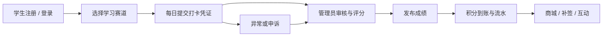
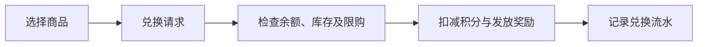
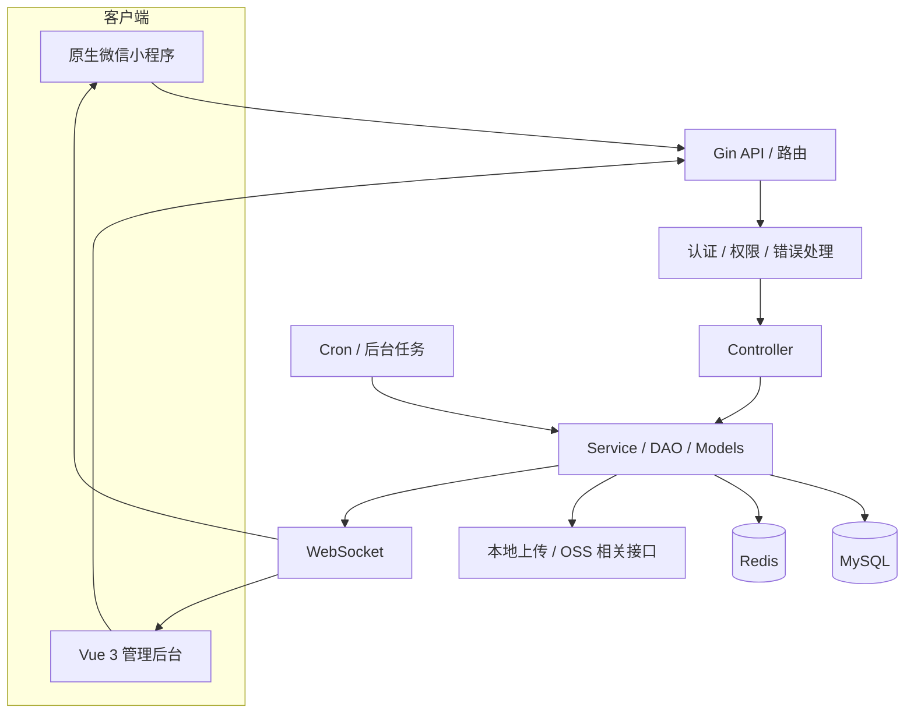

# 星迹 · Smart Check-in 1.0

**学风建设月智能打卡系统 | 校园学习活动与积分运营平台**

       

星迹是面向高校学风建设活动的三端一体软件系统，以学生微信小程序、Web 管理后台和 Go 单体服务为核心，覆盖多赛道打卡、审核发榜、积分激励、商城兑换、申诉与活动运营。

Smart Check-in 1.0 is a campus learning activity platform combining a WeChat Mini Program, a Vue administration dashboard and a Go backend.

> **项目状态：** 2026 年上半年曾正式上线并服务真实校园活动。当前仓库为 1.0 本地归档版本，部分外部服务及实验性功能已停用，现纳入保护性维护计划。安全修复和完整运行验收尚未完成，请勿直接部署至公网或使用真实学生数据。

## 目录

- [项目背景](#项目背景)
- [核心功能](#核心功能)
- [业务流程](#业务流程)
- [系统架构](#系统架构)
- [技术栈](#技术栈)
- [数据模型](#数据模型)
- [工程目录](#工程目录)
- [本地运行指南](#本地运行指南)
- [安全隐私与维护](#安全隐私与维护)
- [项目演进](#项目演进)
- [开发者与使用说明](#开发者与使用说明)

## 项目背景

星迹源于真实的校园学风建设月活动需求，希望将传统人工收集、汇总、审核和积分统计转换为可追踪的线上流程。开发过程中形成了以学生小程序为参与入口、Web 后台为运营入口、Go API 为统一业务中枢的系统。项目曾实际投入活动运行，积累了用户参与、审核、积分发放、服务器部署和运维方面的实践经验。

2026 年 6 月 11 日，归档源码提交 GitHub。仓库并非历史生产环境的完整镜像；真实业务数据库、个人资料、线上凭据与上传文件不属于公开展示内容。

### 历史运营情况

2026 年 5 月 28 日的历史赛道报名统计如下，来自此前活动运营记录，不包含个人身份信息。

| 赛道 | 学习方向 | 报名人次 |
| --- | --- | ---: |
| 墨香伴读 | 阅读 | 44 |
| 语路通行 | 英语 | 89 |
| 马上精进 | 编程 | 67 |
| 逐光运动 | 运动 | 74 |
| 合计 | 四条赛道 | 274 |

学生可以选择多个赛道，274 为报名关系数量，并非独立用户数或并发连接数。本轮未从原始数据库重新核验，不作为性能或容量证明。

## 核心功能

### 学生端 · 微信小程序

| 模块 | 功能 |
| --- | --- |
| 身份与账号 | 注册、登录、微信绑定、资料维护、找回密码 |
| 学习赛道 | 赛道选择、任务说明、调整与历史记录 |
| 每日打卡 | 图文凭证、记录查询与编辑、运动步数相关能力 |
| 积分激励 | 德育分、赋能分、积分记录、补签卡 |
| 学风驿站 | 商品浏览、积分兑换、兑换记录 |
| 申诉反馈 | 问题反馈、截图、申诉进度与处理结果 |
| 社区互动 | 公告、优秀打卡展示、点赞及评论 |
| 创意工坊 | 基于虚拟积分的抽取及大乐透玩法 |

### 管理端 · Web 运营后台

| 模块 | 功能 |
| --- | --- |
| 运营大盘 | 打卡进度、积分统计、运行指标 |
| 学生档案 | 资料、赛道、账号状态、批量操作与导出 |
| 赛道与审核 | 打卡审核、人工评分、成绩发布 |
| 积分运营 | 奖励、惩戒、撤销及流水 |
| 商城管理 | 商品、库存、限购、兑换及补签卡 |
| 申诉大厅 | 分类、处理、回复及奖励 |
| 社区管理 | 公告、打卡推流及内容管理 |
| 创意玩法 | 奖池、开奖、参与状态及功能开关 |
| 系统管理 | 管理员、菜单及动作权限、设备与动态配置 |

### 后端服务

- Gin HTTP 路由与统一响应；GORM 数据模型及 MySQL 持久化。
- JWT、bcrypt、RBAC、Redis 登录态及设备管理相关实现。
- WebSocket 实时通知、设备下线消息及运营数据广播。
- Cron 周期任务、发榜及创意玩法调度。
- 上传凭证、积分流水、兑换、申诉等业务服务。

### 当前归档范围

| 功能 | 当前状态 |
| --- | --- |
| 图文打卡、人工审核、积分与商城 | 保留原有实现，等待回归验收 |
| 四条历史赛道 | 保留原有业务规则与配置能力，非完全通用赛道引擎 |
| AI / OCR | 保留流程及接口结构，真实外部调用已停用 |
| 学风指数站 | 相关实验模型及服务代码封存，不是可用的完整功能 |
| 微信正式登录、运动及对象存储 | 依赖外部配置或实际环境，当前未复验 |

功能表描述源码中的已有实现，不表示每一项已通过完整验收。

## 业务流程

### 每日打卡与审核



打卡记录包含用户、赛道、日期、文本、图片、审核状态与评分等信息。管理端审核后通过发布流程更新积分并记录流水。

### 商城兑换



图示表达目标业务流程；实际事务一致性、幂等性及异常补偿仍需维护验收。

## 系统架构

采用 Go 单体后端、独立 Vue 管理后台及原生微信小程序，不使用微服务。



MySQL 保存用户、打卡、积分、商城等持久化数据；Redis 承担部分会话、设备状态、短锁及风控状态；WebSocket 用于实时消息；定时任务用于周期调度。该架构图为逻辑示意，不能替代安全与一致性验证。

## 技术栈

| 层次 | 技术 |
| --- | --- |
| 后端 | Go（go.mod 声明 1.25.0）、Gin 1.12.0 |
| ORM | GORM 1.25.9、MySQL Driver |
| 数据与状态 | MySQL、go-redis v9 |
| 通讯与调度 | Gorilla WebSocket、robfig/cron v3 |
| 认证与权限相关 | JWT v5、bcrypt、RBAC |
| 管理后台 | Vue 3、TypeScript、Vite |
| UI 与状态管理 | Element Plus、Pinia、Vue Router、Tailwind CSS |
| 可视化与请求 | ECharts、Axios |
| 移动端 | 微信小程序 JS / WXML / WXSS |
| 历史外部集成 | 阿里云 OSS SDK、火山引擎 OCR、DeepSeek |

准确版本及构建要求以 [go.mod](checkin/go.mod)、[管理后台 package.json](checkin-system/package.json)、[小程序 package.json](miniprogram-1/package.json) 为准。

## 数据模型

| 领域 | 主要模型 |
| --- | --- |
| 用户与身份 | User、AdminUser、AuthApproval、ClassList |
| 打卡与赛道 | Track、UserTrack、CheckinRecord、UserMakeupLog |
| 积分与商城 | ScoreLog、ShopItem、UserPurchaseRecord |
| 申诉 | AppealRecord、AppealCategory、BugReport |
| 社区 | CommunityPost、CommunityComment、CommunityLike、GlobalNotice、BountyTask |
| 创意玩法 | UserLottoEntry、LottoSetting、LottoPoolLog |
| 权限与配置 | SysAdminMenuPerm、SysAdminActionPerm、SysAdminTrackRelation、SystemDynamicConfig |

模型位于 [checkin/models](checkin/models)。系统采用积分流水等机制记录运营操作，数据完整性、并发一致性和权限边界仍需保护性维护验证。

## 工程目录

```text
smart-checkin-system/
├── README.md
├── .gitignore
├── checkin/                    # Go 单体后端
│   ├── cmd/                    # 启动入口
│   ├── common/                 # 通用响应
│   ├── config/                 # 配置定义
│   ├── controller/             # HTTP 控制器
│   ├── service/                # 业务服务
│   ├── dao/                    # 数据访问辅助
│   ├── models/                 # GORM 模型
│   ├── middleware/             # 中间件
│   ├── router/                 # 路由
│   ├── security/               # 设备及会话管理
│   ├── initialize/             # 初始化
│   ├── global/                 # 全局资源
│   ├── cron/                   # 定时任务
│   ├── websocket/              # 实时通信
│   ├── utils/
│   ├── go.mod
│   └── .env.example
├── checkin-system/             # Vue + TypeScript 管理后台
│   ├── src/
│   │   ├── api/
│   │   ├── layout/
│   │   ├── router/
│   │   ├── store/
│   │   ├── utils/
│   │   └── views/
│   ├── package.json
│   └── package-lock.json
├── miniprogram-1/              # 原生微信小程序
│   ├── pages/
│   ├── custom-tab-bar/
│   ├── utils/
│   ├── assets/
│   ├── app.json
│   ├── config.js
│   └── package.json
├── scripts/
└── index.html
```

### 关键源码入口

| 文件 | 用途 |
| --- | --- |
| [checkin/cmd/main.go](checkin/cmd/main.go) | 后端启动 |
| [checkin/router/router.go](checkin/router/router.go) | API 路由 |
| [checkin/initialize/db.go](checkin/initialize/db.go) | 数据库初始化 |
| [checkin/initialize/config.go](checkin/initialize/config.go) | 环境变量与配置 |
| [checkin-system/src/router/index.ts](checkin-system/src/router/index.ts) | 管理端路由 |
| [checkin-system/src/api/request.ts](checkin-system/src/api/request.ts) | 后台 API 请求 |
| [miniprogram-1/app.json](miniprogram-1/app.json) | 小程序页面配置 |
| [miniprogram-1/config.js](miniprogram-1/config.js) | 小程序服务地址 |

### API 模块导航

| 路由前缀 | 职责 |
| --- | --- |
| `/api/auth` | 账号、注册、登录及授权辅助 |
| `/api/checkin`、`/api/track` | 打卡及赛道 |
| `/api/user`、`/api/shop` | 个人信息及商城 |
| `/api/ticket`、`/api/community` | 申诉及社区 |
| `/api/game`、`/api/message` | 创意玩法及消息 |
| `/api/admin`、`/api/superadmin`、`/api/sub-admin` | 后台管理 |
| `/api/ws` | WebSocket |

实际接口、请求方式及权限边界以路由和维护验收结果为准。

## 本地运行指南

以下依据现有源码整理，尚未进行本轮洁净环境完整联调。仅用于隔离的本地测试，使用虚拟学生资料和独立数据库，不连接历史生产环境。

### 1. 环境准备

- Go 工具链：项目声明 Go 1.25.0，实际依赖所需版本以构建结果为准。
- MySQL 8.x、Redis。
- Node.js（建议 22 LTS）、npm。
- 微信开发者工具。

```bash
git clone https://github.com/XUANFU-h/smart-checkin-system.git
cd smart-checkin-system
```

### 2. 配置 MySQL 与 Redis

在专用测试数据库实例中创建数据库并配置专用账号：

```sql
CREATE DATABASE smart_checkin CHARACTER SET utf8mb4 COLLATE utf8mb4_unicode_ci;
```

启动时包含 GORM AutoMigrate，不要对历史数据库或生产数据库直接执行自动迁移。

### 3. 配置并启动后端

```bash
cd checkin
cp .env.example .env
```

Windows PowerShell 使用 `Copy-Item .env.example .env`。根据模板编辑本地 `.env`：

| 变量 | 说明 |
| --- | --- |
| SERVER_PORT | 默认 8080 |
| DB_HOST / DB_PORT / DB_NAME | 本地 MySQL 地址、端口与数据库 |
| DB_USER / DB_PASSWORD | 专用测试账号及强密码 |
| REDIS_HOST / REDIS_PORT / REDIS_PASSWORD / REDIS_DB | 本地 Redis 配置 |
| JWT_SECRET | 本地生成的高熵随机密钥 |
| SUPER_ADMIN_SECURE_KEY | 独立生成的安全密钥（历史认证逻辑仍待修复） |
| WX_APPID / WX_SECRET | 按测试需要提供微信环境配置 |
| OSS、OCR、DeepSeek 等 | 历史外部集成配置，不使用历史生产凭据 |

首次启动前，应检查历史认证逻辑和外部服务配置，确保隔离环境不会连接远程生产服务。当前版本不保证安全默认初始化或一键创建演示账号。

```bash
go mod download
go run ./cmd
```

默认 API 前缀为 `http://127.0.0.1:8080/api`，实际端口由配置读取。

### 4. 启动 Vue 管理后台

另开终端，在仓库根目录执行：

```bash
cd checkin-system
npm ci
npm run dev -- --host 127.0.0.1
```

打开 Vite 输出的本地地址（通常为 `http://127.0.0.1:5173`）。开发请求默认指向本机 8080 端口；如果变更后端地址，应同步调整前端配置。

### 5. 启动微信小程序

1. 在微信开发者工具导入 `miniprogram-1/`。
2. 根据本地测试需求选择合法的测试 AppID 或测试模式。
3. 如需 npm 依赖，在小程序目录执行 `npm ci`，并在开发者工具中构建 npm。
4. 检查 `config.js` 的 API 与 WebSocket 地址。
5. 本地模拟器可使用开发工具的本地调试选项；真机联调须使用可达的测试地址，正式发布须满足微信平台相关要求。

本地模式下，真实微信登录、微信运动、对象存储等仍可能受外部服务配置限制。

### 6. 构建与测试

后端：

```bash
cd checkin
go build ./cmd
go test ./...
```

管理后台（从仓库根目录开始）：

```bash
cd checkin-system
npm ci
npm run build
```

这些是源码对应的构建与测试入口，不表示已经测试通过。小程序需在微信开发者工具中编译并进行业务验证。

## 安全隐私与维护

当前归档源码包含历史认证、授权及业务一致性方面的待修复问题。JWT、RBAC、设备绑定、Redis 短锁等属于已有机制，不能作为安全审计通过的证明。

保护性维护计划包括：

- 认证与权限检查、管理员安全、会话及设备状态。
- 打卡去重、发榜幂等性、积分流水、库存及兑换事务。
- 数据隐私、上传验证、错误处理、依赖检查及测试。
- 前后端接口兼容、脱敏演示及可复现部署文档。

维护原则为保留原有 Go 单体架构、前端页面及核心业务规则，不新增 2.0 功能，不重新设计整个系统。

真实姓名、学号、班级、打卡凭证、积分、申诉内容、数据库导出及日志不得公开。不得提交真实 `.env`、JWT 密钥、微信 AppSecret、OSS Key 或 OCR / AI 密钥。历史凭据若曾泄露应立即作废或轮换，并检查 Git 历史；`.gitignore` 不会删除已提交的文件。

安全修复及验收通过前，仅适合隔离本地复盘与作品展示，不建议公开部署。当前没有经过本轮验证的压力测试、安全测试或可用性指标。

## 项目演进

| 阶段 | 说明 |
| --- | --- |
| 2026 年上半年 | 学风建设月活动需求、开发与正式上线 |
| 2026 年 5 月 | 校园活动参与及多赛道运营 |
| 2026 年 6 月 11 日 | 归档源码提交 GitHub |
| 2026 年 11 月 | 1.0 纳入保护性维护计划 |
| 后续产品 | 逐迹 · Smart Check-in 2.0（独立研发中） |

逐迹 2.0 将在历史运营经验基础上重新设计，规划支持充分可配置的赛道、AI/OCR 自动评分及学风指数站等能力。上述是新版本目标，而非本仓库已交付功能。

相关早期项目：[星裁 & 星守](https://github.com/XUANFU-h/xingcai-xingshou)。

## 开发者与使用说明

开发者：[XUANFU-h](https://github.com/XUANFU-h)。项目实践涉及需求与产品设计、AI 辅助全栈开发、前后端集成、小程序开发、活动运营及服务器部署维护。本仓库用于个人项目展示、学习复盘及历史版本维护。

当前仓库未见独立 LICENSE 文件；公开可访问源码不等于授予任意再分发或商业使用许可。第三方依赖及资源遵循其各自许可。

---

**星迹 · Smart Check-in 1.0 | 2026**
