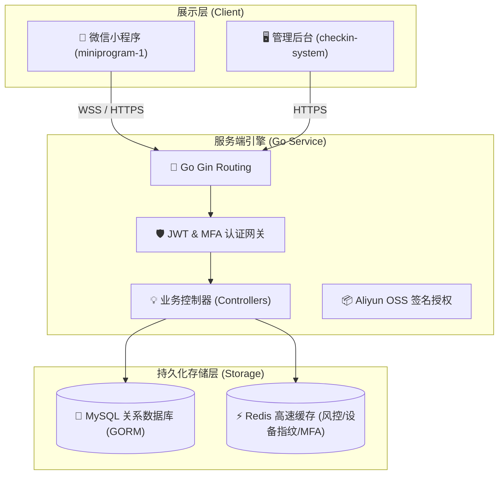

# 🎓 学风建设月智能打卡系统 (Smart Checkin System)

> **基于 Go Gin + Vue 3 + 微信小程序的高性能、精细化多赛道考勤及学风积分运营平台。**

---

## 🎨 系统架构与核心特性

本系统采用**微内核、高并发、安全自愈**的设计理念，专为高校/机构考勤及学风建设场景量身定制。支持多赛道（图文/文档/运动）考勤流水分流、学风积分（德育/赋能）双维积分运营、积分商城兑换、大乐透/创意工坊趣味化玩法以及细粒度的权限隔离。



---

## ✨ 核心功能模块

### 📱 1. 微信考勤打卡客户端 (WeChat Miniprogram)
- **多赛道分流打卡**：支持图文赛道（多图直传）与文档赛道（多格式文档上载），满足多样化考勤需求。
- **状态驱动型日历**：日历格子通过色码直观呈现考勤状态（🟢已完成/🟡部分打卡/🔴已过截止时间缺卡/🔵卡片补签解锁）。
- **云端同步补签卡**：消耗积分兑换补签卡，秒级激活历史缺卡日期，支持换手机及清缓存漫游自愈。
- **微信步数打卡**：支持调用微信原生运动步数 API，实现健步赛道数据自动抓取与步数自动校验。
- **趣味创意工坊**：内嵌老虎机抽奖、五子棋对战等益智小游戏，融合学风积分赢取机制。

### 🖥️ 2. 干事与管理员运营大盘 (Vue 3 Admin Panel)
- **多级 RBAC 权限隔离**：支持大管理员（超级权限）与二级干事（菜单/动作功能权限受限，赛道数据物理隔离）。
- **一键熔断锁定**：一键开启“创意工坊全局锁”，小程序端界面瞬间使能磨砂毛玻璃遮罩并锁死交互。
- **可视化打卡复核**：支持对学生的打卡凭证进行双重打分（德育值、赋能值），支持快捷驳回并发送站内信。
- **系统状态遥测**：集成 CPU、内存及网络延迟的物理探针，实时遥测服务器健康状况。

### 🚀 3. 高性能业务网关 (Go Backend Engine)
- **双重锁与防刷机制**：通过 `userLocks` 并发悲观锁与 Redis 3秒冷却拦截器，彻底解决并发脚本刷打卡问题。
- **MFA 多因子认证**：支持 Google Authenticator MFA 安全绑定，保障管理员后台登录高安全级防护。
- **设备防挤占拦截**：实时捕获 `X-Device-Id` 设备指纹，非管理员账号自动限制单设备登录，同账号异地登录物理下线。

---

## 🛠️ 技术栈清单

| 层次 | 技术/框架名称 | 版本 | 描述 |
| :--- | :--- | :--- | :--- |
| **后端 API** | Go (Gin Engine) | 1.20+ | 高性能 Web 路由网关 |
| **数据库 ORM** | GORM | v1.25+ | 关系型数据库对象关系映射 |
| **缓存/风控** | Go-Redis | v9+ | 用于设备指纹、速率限制及 Token 黑名单 |
| **认证安全** | JWT & Totp MFA | HS256 | JWT 会话校验与二次双因子身份认证 |
| **管理后台** | Vue 3 + TypeScript | 3.x / Vite | 现代化单页面应用前端框架 |
| **UI 组件库** | Element Plus | Latest | 美观的企业级组件库 |
| **小程序端** | WeChat Native | ES6 / WXML | 原生微信小程序技术栈 |

---

## 📂 项目目录树

```text
smart-checkin-system/
├── checkin/                 # 🚀 Go 后端工程根目录
│   ├── cmd/                 # 入口启动主文件 (main.go)
│   ├── controller/          # 业务控制器层 (打卡、商城、系统设置、MFA)
│   ├── middleware/          # 管道中间件 (CORS、JWT拦截、RBAC权限守卫)
│   ├── models/              # GORM 数据库结构体定义
│   ├── router/              # Gin 路由注册总线
│   ├── service/             # 核心业务逻辑实现 (AI流水线、微信授权、OCR)
│   └── initialize/          # 数据库、Redis 连接初始化及 Seed 种子数据
├── checkin-system/          # 🖥️ Vue 3 管理后台前端根目录
│   ├── src/
│   │   ├── api/             # 统一封装的后台 Axios 网络请求
│   │   ├── store/           # Pinia 状态管理 (权限、用户状态)
│   │   └── views/           # 页面视图 (审核、数据大盘、大乐透、系统配置)
│   └── vite.config.ts       # Vite 构建编译配置
└── miniprogram-1/           # 📱 微信小程序客户端根目录
    ├── pages/               # 页面 (日历打卡、打卡表单、创意工坊、商城)
    ├── utils/               # request.js 网关代理与通用工具
    └── app.json             # 微信小程序页面路由与全局配置
```

---

## 🏁 快速开始与部署

### 1. 后端 Go 服务部署
1. 进入 `checkin` 目录，新建并配置 `.env` 配置文件：
   ```ini
   DB_HOST=127.0.0.1
   DB_PORT=3306
   DB_USER=root
   DB_PASS=您的数据库密码
   DB_NAME=smart_checkin
   REDIS_HOST=127.0.0.1
   REDIS_PORT=6379
   JWT_SECRET=您的安全密钥
   ```
2. 运行并拉取依赖：
   ```bash
   go mod download
   ```
3. 启动本地服务：
   ```bash
   go run cmd/main.go
   ```

### 2. 管理端前端部署
1. 进入 `checkin-system` 目录，安装依赖：
   ```bash
   npm install
   ```
2. 启动开发服务器：
   ```bash
   npm run dev
   ```
3. 执行生产打包编译：
   ```bash
   npm run build
   ```

### 3. 微信小程序运行
1. 打开 **微信开发者工具**；
2. 导入 `miniprogram-1` 目录；
3. 将 `config.js` 中的 `domain` 修改为您的后端服务器 API 域名；
4. 勾选“不校验合法域名、web-view 业务域名”，即可开始真机调试与预览。

---

## 🔒 开源安全规范
1. 生产环境部署时，必须修改默认的大超管双因子暗号凭证；
2. 任何情况下**严禁**将包含私密配置参数的 `.env` 或 `config.yaml` 提交至 GitHub 仓库；
3. 数据库必须限制外部 IP 直连权限，仅放行服务端所在主机的内网 IP 访问。
