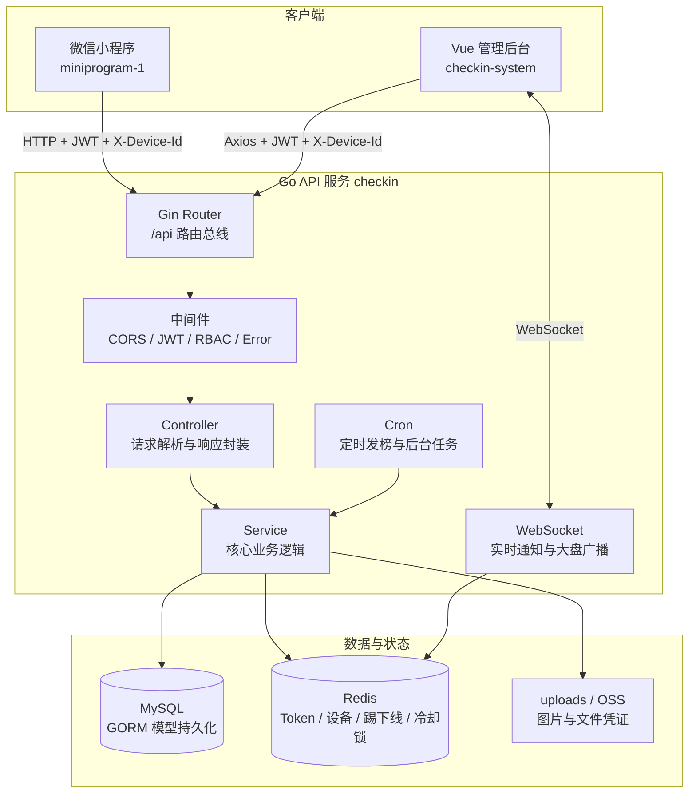
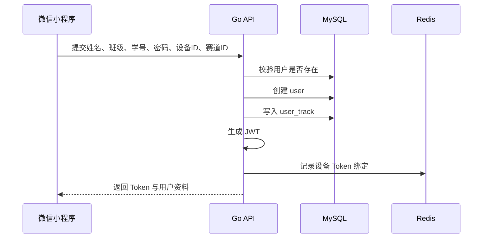
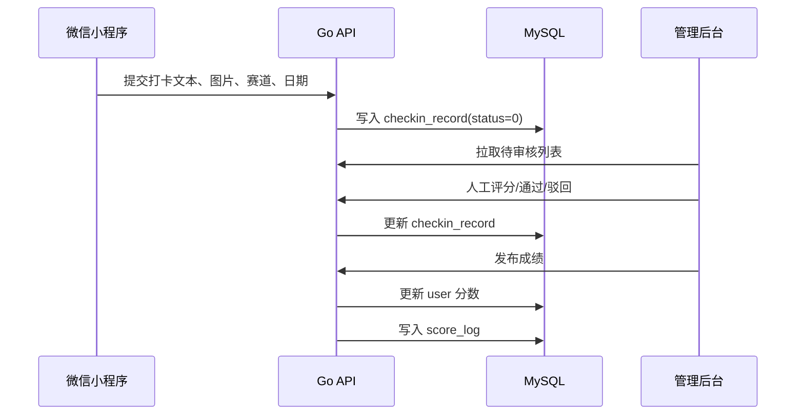
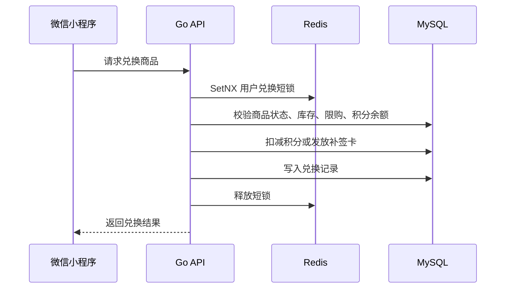
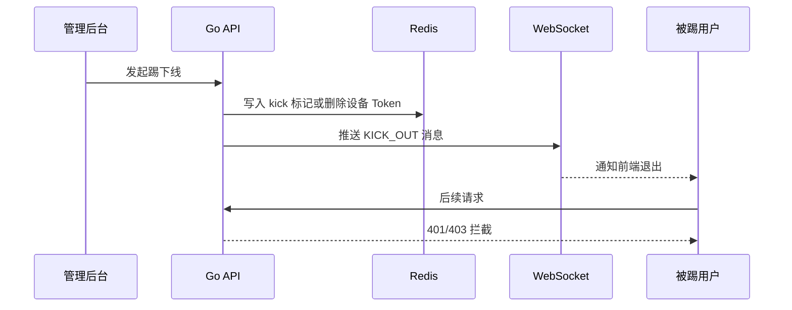

# 学风建设月智能打卡系统

Smart Checkin System 是一个面向高校学风建设、活动打卡、积分运营和后台精细化管理的三端一体系统。项目由 Go 后端服务、Vue 3 管理后台、原生微信小程序组成，围绕“学生每日多赛道打卡、管理员审核评分、德育分/赋能分运营、商城兑换、申诉工单、社区展示、创意玩法和实时管控”构建完整闭环。

当前仓库已经转为本地开发与归档维护版本，默认后端地址为 `http://127.0.0.1:8080`，敏感配置、数据库导出、Excel 导出结果、日志、二进制文件均不应提交到 GitHub。

## 目录

- [系统定位](#系统定位)
- [总体架构](#总体架构)
- [技术栈](#技术栈)
- [后端实现](#后端实现)
- [管理后台实现](#管理后台实现)
- [微信小程序实现](#微信小程序实现)
- [核心业务流程](#核心业务流程)
- [数据模型设计](#数据模型设计)
- [安全与权限设计](#安全与权限设计)
- [项目目录结构](#项目目录结构)
- [本地运行](#本地运行)
- [隐私与开源注意事项](#隐私与开源注意事项)

## 系统定位

这个系统解决的是“活动周期内，大量学生分赛道参与任务、按日期提交打卡凭证、管理员审核并发放积分、学生用积分参与兑换和趣味玩法”的运营问题。

它不是单纯的打卡表单，而是围绕活动运营做了一整套业务能力：

- 学生端完成注册、登录、赛道选择、每日打卡、历史记录查看、补签卡使用、商城兑换、申诉反馈、消息接收、创意玩法参与。
- 管理端完成学生档案维护、赛道配置、打卡审核、积分发放与撤销、申诉处理、社区内容管理、商城库存管理、管理员权限分配、全局风控与实时数据监控。
- 服务端统一承载认证、权限、打卡流水、积分流水、商城交易、游戏抽奖、WebSocket 推送、Redis 风控状态、MySQL 持久化模型。

## 总体架构



后端启动链路位于 `checkin/cmd/main.go`：

1. `initialize.InitConfig()` 读取 `.env` 与系统环境变量，组装 MySQL、Redis、JWT、微信、AI、OSS 等配置。
2. `initialize.InitDB()` 连接 MySQL，通过 GORM 自动迁移核心表结构。
3. `initialize.InitRedis()` 初始化 Redis 客户端。
4. `service.StartGameCron()` 启动游戏相关周期任务。
5. `service.StartDashboardCronEngine()` 周期性采集大盘数据并广播。
6. `cron.SetupCronJobs()` 挂载定时发榜、积分发布等任务。
7. `router.SetupRouter()` 注册 Gin 路由、中间件、静态资源、WebSocket。
8. `r.Run(":8080")` 启动本地服务。

## 技术栈

### 后端

| 技术 | 版本/依赖 | 用途 |
| --- | --- | --- |
| Go | `go 1.25.0` | 后端主语言 |
| Gin | `github.com/gin-gonic/gin v1.12.0` | HTTP 路由、接口网关、中间件 |
| GORM | `gorm.io/gorm v1.25.9` | ORM、模型迁移、MySQL 访问 |
| MySQL Driver | `gorm.io/driver/mysql v1.5.6` | MySQL 数据库驱动 |
| Redis | `github.com/redis/go-redis/v9 v9.5.1` | 登录态、设备态、风控态、短锁 |
| JWT | `github.com/golang-jwt/jwt/v5 v5.2.1` | 用户与管理员认证 |
| WebSocket | `github.com/gorilla/websocket v1.5.3` | 实时踢下线、大盘通知、全局消息 |
| Cron | `github.com/robfig/cron/v3 v3.0.1` | 定时发榜、后台任务 |
| bcrypt | `golang.org/x/crypto` | 密码哈希 |
| godotenv | `github.com/joho/godotenv v1.5.1` | 本地环境变量加载 |
| base64Captcha | `github.com/mojocn/base64Captcha v1.3.8` | 验证码 |
| Aliyun OSS SDK | `github.com/aliyun/aliyun-oss-go-sdk` | OSS 上传签名能力 |
| gmsm | `github.com/tjfoc/gmsm v1.4.1` | 国密相关加密能力预留/使用 |

### 管理后台

| 技术 | 版本/依赖 | 用途 |
| --- | --- | --- |
| Vue 3 | `vue ^3.5.13` | 管理后台 SPA |
| TypeScript | `typescript ^5.7.3` | 类型约束 |
| Vite | `vite ^6.0.0` | 开发服务器与构建工具 |
| Vue Router | `vue-router ^4.5.0` | 页面路由 |
| Pinia | `pinia ^2.3.1` | 权限与状态管理 |
| Axios | `axios ^1.7.9` | API 请求封装 |
| Element Plus | `element-plus ^2.9.3` | 后台 UI 组件 |
| ECharts | `echarts ^6.1.0` | 数据可视化 |
| Tailwind CSS | `tailwindcss ^3.4.17` | 页面样式辅助 |
| unplugin-auto-import / components | `^19.0.0` / `^28.0.0` | 自动导入与组件按需注册 |

### 微信小程序

| 技术 | 用途 |
| --- | --- |
| 原生小程序 JS/WXML/WXSS | 学生端、移动端活动入口 |
| 自定义 tabBar | 首页、创意工坊、个人中心、打卡入口 |
| `wx.request` / `wx.uploadFile` | API 请求与图片上传 |
| `wx.login` | 微信登录链路 |
| `wx.getWeRunData` | 微信运动步数打卡 |
| `sm-crypto` | 小程序端国密算法依赖 |

## 后端实现

后端工程位于 `checkin/`，采用典型的“路由层 -> 控制器层 -> 服务层 -> 数据层”结构。

### 路由组织

路由集中在 `checkin/router/router.go`，统一挂载到 `/api` 下。

开放接口：

- `/api/auth/register`：学生注册并选择赛道。
- `/api/auth/login`：学生或管理员登录。
- `/api/auth/wxlogin`：微信登录。
- `/api/auth/forgot-password/apply`：找回密码申请。
- `/api/auth/forgot-password/reset`：找回密码重置。
- `/api/auth/experience/apply`：体验账号申请。
- `/api/auth/classes`：班级列表。
- `/api/auth/tracks`：赛道列表。
- `/api/auth/captcha/generate`：验证码生成。
- `/api/auth/oss-signature`：OSS 上传签名。
- `/api/auth/check-bind-status`、`/api/auth/login-qr-generate`、`/api/auth/login-qr-check`：微信扫码绑定与登录辅助接口。

登录后接口：

- `/api/checkin/*`：打卡提交、编辑、详情、删除、图片上传、我的打卡记录。
- `/api/ticket/*`：申诉分类、申诉提交、申诉列表、撤销申诉。
- `/api/community/*`：社区帖子、公告、点赞、评论。
- `/api/track/*`：我的赛道、赛道详情、排行榜。
- `/api/user/*`：个人信息、历史打卡、积分信息、头像、资料、注销申请、改选赛道、绑定微信、使用补签卡。
- `/api/shop/*`：商城列表、兑换商品。
- `/api/game/*`：大乐透、老虎机、五子棋奖励、历史记录。
- `/api/message/*`：站内信未读数、列表、全部已读。
- `/api/ws`：WebSocket 连接。

管理员接口：

- `/api/admin/*`：普通管理员与子管理员可访问的后台接口。
- `/api/superadmin/*`：超级管理员专属接口。
- `/api/sub-admin/*`：兼容子管理员前端路径的接口组。

### 中间件设计

后端中间件位于 `checkin/middleware/`：

- `CorsMiddleware`：处理跨域请求。
- `GlobalErrorMiddleware`：统一错误捕获与响应。
- `JWTAuthMiddleware`：解析 Bearer Token，校验 JWT、用户状态、设备状态、踢下线状态。
- `RequireAdmin`：限制管理员或超级管理员访问。
- `RequireSuperAdmin`：限制超级管理员访问。
- `RequireAction`：细粒度动作权限守卫，子管理员需要在 `sys_admin_action_perm` 中拥有对应动作权限。

认证链路同时使用 `Authorization` 与 `X-Device-Id`。前端和小程序都会在请求头中携带设备标识，后端据此在 Redis 中校验当前设备的 Token 是否仍然有效。

### 配置加载

`checkin/initialize/config.go` 通过 `godotenv` 读取 `.env`，并允许系统环境变量覆盖。主要配置包括：

- `SERVER_PORT`
- `DB_HOST`、`DB_PORT`、`DB_NAME`、`DB_USER`、`DB_PASSWORD`、`DB_URL`
- `REDIS_HOST`、`REDIS_PORT`、`REDIS_PASSWORD`
- `JWT_SECRET`、`JWT_EXPIRE_HOURS`
- `WX_APPID`、`WX_SECRET`
- `DEEPSEEK_API_KEY`、`DEEPSEEK_BASE_URL`、`DEEPSEEK_MODEL`
- `OSS_ENDPOINT`、`OSS_BUCKET`、`OSS_ACCESS_KEY_ID`、`OSS_ACCESS_KEY_SECRET`
- `VOLC_OCR_AK`、`VOLC_OCR_SK`、`VOLC_OCR_ENDPOINT`

仓库只保留 `checkin/.env.example`，真实 `.env` 被 `.gitignore` 排除。

### 数据库初始化

`checkin/initialize/db.go` 使用 GORM 连接 MySQL，并设置连接池：

- 最大空闲连接：20
- 最大打开连接：100
- 连接最大生命周期：1 小时

启动时自动迁移核心模型，包括用户、班级、打卡记录、赛道、用户赛道关系、积分流水、商城、抽奖、申诉、管理员权限、社区、公告等表。

### 打卡与赛道

打卡核心模型位于 `checkin/models/checkin.go`：

- `Track`：赛道定义，包括名称、描述、类型、要求、分数范围、启用状态。
- `UserTrack`：学生与赛道的多对多关系。
- `CheckinRecord`：每条打卡记录，包括用户、赛道、文本、图片、审核状态、AI 分数、评语、OCR 文本、发布日期、是否推送社区、打卡日期。
- `UserMakeupLog`：补签卡日期解锁记录。

打卡接口支持：

- 按赛道提交图文凭证。
- 修改已有打卡。
- 查询记录详情。
- 删除自己的打卡记录。
- 获取我的赛道打卡历史。
- 上传图片或凭证文件。

审核状态通过 `status` 表示：

- `0`：待审核。
- `1`：通过。
- `2`：驳回。
- `3`：警告。
- `4`：风控拦截。

### 审核、发榜与积分

打卡审核由管理端通过 `/api/admin/audit/list` 获取列表，通过 `/api/admin/evaluate` 人工评分，通过 `/api/admin/audit/publish` 发布成绩。

积分体系分为两类：

- `EMPOWER`：赋能分，主要与赛道打卡、奖励、消费相关。
- `MORAL`：德育分，主要与德育评价、申诉奖励、惩戒相关。

积分流水使用 `ScoreLog` 保存，每次加分、扣分、撤销、兑换都能留下：

- 用户 ID
- 积分类型
- 分值
- 操作类型
- 原因
- 操作人
- 创建时间

`service/ai_pipeline_service.go` 中保留了 AI/OCR 流水线结构。当前本地归档版本中，AI 与 OCR 外部调用已做本地安全处理，主要流程转向人工审核与手动发布，避免继续依赖线上 API Key。

### 申诉工单

申诉模型位于 `checkin/models/ticket.go`：

- `AppealRecord`：用户申诉或 Bug 反馈记录。
- `AppealCategory`：申诉分类，可配置是否需要截图。

学生可以提交申诉、上传截图、查看申诉进度、撤销申诉。管理员可以按状态、日期、关键词筛选处理，选择通过或驳回，并可在通过时附带积分奖励。

### 商城兑换

商城模型位于 `checkin/models/log.go`：

- `ShopItem`：商品名称、类型、消耗、奖励值、库存、限购、上下架时间、目标班级。
- `UserPurchaseRecord`：用户兑换记录与限购计数。

用户端可以浏览商品并兑换。后端在兑换时使用 Redis 短锁，例如 `shop_exchange_lock:U{userId}`，避免重复点击造成并发兑换。

商城支持的商品类型包括：

- 德育分兑换。
- 赋能分兑换。
- 补签卡。
- 限时商品。
- 限库存商品。
- 限班级商品。

### 创意玩法

游戏相关模型位于 `checkin/models/game_play.go`，服务位于 `checkin/service/game_service.go`：

- `UserLottoEntry`：大乐透参与记录、锁定号码、期数、中奖状态、旋转次数。
- `LottoSetting`：每一期的开奖号码、奖励类型、奖励值、是否已开奖。
- `LottoPoolLog`：奖池变动流水。

小程序创意工坊通过 `/api/game/*` 接口参与：

- 每日完成打卡后获得免费老虎机机会。
- 可消耗积分继续抽取。
- 可锁定号码参与本期大乐透。
- 管理端可设置奖池、开奖、奖项配置、清理参与者、控制创意工坊开关。

### 社区与公告

社区模型位于 `checkin/models/community.go`：

- `CommunityPost`：官方公告、打卡推流、用户动态。
- `CommunityComment`：帖子评论。
- `CommunityLike`：点赞关系。
- `BountyTask`：悬赏任务。
- `GlobalNotice`：全局公告弹窗。

管理员可以将优秀打卡内容推送到社区，也可以发布官方公告、置顶、排序、管理悬赏任务和全局通知。用户端可以浏览、点赞、评论、查看公告。

### 实时监控与 WebSocket

项目使用 `github.com/gorilla/websocket` 建立实时通信。WebSocket 用于：

- 管理后台全局连接。
- 被踢下线设备的实时通知。
- 大盘数据和服务器遥测广播。
- 全局风控状态同步。

`service.StartDashboardCronEngine()` 会周期性采集打卡进度、积分统计、最近流水等数据，并通过 `websocket.Manager.BroadcastToAll` 推送到管理端。

### 权限与管理员体系

管理员模型位于 `checkin/models/system.go` 和 `checkin/models/rbac.go`：

- `AdminUser`：管理员账号、角色等级、绑定学号、绑定微信状态、密钥过期时间。
- `SysAdminMenuPerm`：菜单权限。
- `SysAdminActionPerm`：动作权限。
- `SysAdminTrackRelation`：管理员可管理的赛道范围。
- `SysAdminPermission`：兼容旧版权限结构。

权限分为三层：

1. 登录态认证：JWT 是否有效。
2. 角色认证：学生、管理员、超级管理员。
3. 动作认证：例如 `user_ban`、`user_kick`、`user_delete`、`record_delete`、`score_modify`。

这样可以让子管理员只看到或操作自己负责的部分功能，而超级管理员拥有全局管理能力。

### 设备与风控

设备管理位于 `checkin/security/device_manager.go`：

- 登录成功后记录用户、设备、Token 的绑定关系。
- Redis Hash 保存设备与 Token。
- Redis ZSet 记录设备最近活跃顺序。
- 超过最大设备数后，最旧设备会被移除并通过 WebSocket 通知下线。
- 中间件会校验当前请求的 `X-Device-Id` 与 Token 是否匹配。

风控还包括：

- 用户封禁。
- 设备黑名单。
- 批量踢下线。
- 全局踢下线。
- 全局封禁开关。
- Redis 短时间互斥锁，防止重复兑换、重复提交等并发问题。

## 管理后台实现

管理后台位于 `checkin-system/`，是一个 Vue 3 + TypeScript + Vite 单页应用。

### 路由结构

路由位于 `checkin-system/src/router/index.ts`：

- `/login`：管理员登录。
- `/admin/dashboard`：数据面板。
- `/admin/students`：学生档案。
- `/admin/lotto`：创意玩法管理。
- `/admin/audit`：赛道与审核中心。
- `/admin/community`：社区管理。
- `/admin/settings`：系统设置。
- `/admin/appeal`：申诉大厅。
- `/admin/shop`：学风驿站商城。

`router.beforeEach` 会检查本地是否存在 `userToken` 或 `admin_token`，未登录访问后台页面会重定向到登录页。

### 请求网关

请求封装位于 `checkin-system/src/api/request.ts`：

- 自动判断本地环境，开发环境请求 `http://127.0.0.1:8080/api`。
- 自动清洗重复 `/api` 前缀。
- 自动附加 `Authorization: Bearer <token>`。
- 自动生成并携带 `X-Device-Id`。
- 对 401、403、404、500 做统一处理。
- 对登录接口、验证码接口和普通业务接口做兼容解包。

### 全局布局与 WebSocket

布局位于 `checkin-system/src/layout/index.vue`。侧边栏菜单包含：

- 数据面板
- 学生档案
- 赛道管理
- 申诉大厅
- 社区管理
- 创意玩法
- 学风驿站
- 系统设置

布局组件会初始化全局 WebSocket，并在连接断开后自动重连。管理端因此可以接收踢下线、大盘刷新、全局通知等事件。

### 主要页面

#### 数据面板

`src/views/dashboard/index.vue`

用于展示整体运营数据，包括赛道进度、今日打卡情况、积分统计、服务器状态等。后端对应 `/api/admin/dashboard` 与遥测相关接口。

#### 学生档案

`src/views/student/index.vue`

这是管理端最复杂的页面之一，负责：

- 学生列表查询。
- 按班级、关键词筛选。
- 查看姓名、班级、长学号、赛道、分数、账号状态。
- 重置密码。
- 修改学生信息。
- 重置学生赛道。
- 单人或批量奖励。
- 单人或批量惩戒。
- 批量封禁、踢下线。
- 设备级拉黑。
- 全局封禁与全局踢下线。
- 一键导出 Excel。

一键导出功能会整理：

- 序号
- 姓名
- 班级
- 长学号
- 参与赛道数量
- 赋能分
- 德育分
- 单赛道打卡日期明细
- 用户每日打卡数据

#### 赛道与审核中心

`src/views/audit/index.vue`

用于管理赛道、查看各赛道打卡进度、进入具体赛道审核列表、手动评分、发布成绩、删除异常记录、触发 AI 流程、配置赛道要求。

#### 申诉大厅

`src/views/appeal/index.vue`

用于处理学生申诉和 Bug 反馈：

- 待处理、已通过、已驳回分类。
- 按关键词、日期筛选。
- 查看学号、姓名、班级、申诉内容、截图、提交时间。
- 通过时可填写回复和奖励。
- 驳回时填写原因。
- 删除无效申诉。

#### 社区管理

`src/views/community/index.vue`

用于管理官方公告、打卡推流、社区看板、悬赏任务和全局公告弹窗。

#### 创意玩法

`src/views/lotto/index.vue`

用于配置大乐透、老虎机、奖池、参与者、开奖、奖项、创意工坊开关。

#### 学风驿站商城

`src/views/shop/index.vue`

用于管理商城商品、库存、兑换记录、兑换审核、退款等运营动作。

#### 系统设置

`src/views/settings/index.vue`

用于配置系统动态参数，例如打卡截止时间、赛道调整时间、AI/OCR 开关、后台运行参数等。

## 微信小程序实现

小程序位于 `miniprogram-1/`，使用原生小程序技术栈。

### 全局配置

`miniprogram-1/app.json` 注册了完整页面：

- 登录注册：`login`、`register`、`forgotPassword`、`resetPassword`、`pendingApproval`
- 赛道：`trackSelect`、`trackList`、`trackDetail`
- 打卡：`checkin`、`checkinForm`、`stepTracker`、`success`
- 我的：`profile`、`editProfile`
- 运营：`shop`、`appealList`、`appeal`、`appealSuccess`、`message`
- 数据与管理：`dataDashboard`、`adminConsole`
- 创意玩法：`workshop`
- 风控提示：`banned`

小程序使用自定义 tabBar，主要入口是首页、创意工坊、个人中心和打卡页。

### 请求封装

`miniprogram-1/utils/request.js` 封装了 `wx.request`：

- 读取 `config.js` 中的 `baseUrl`。
- 自动修正重复 `/api`。
- 自动携带 `Authorization`。
- 自动携带 `X-Device-Id`。
- 统一处理 401 登录失效。
- 统一处理 403 风控拦截。
- 对后端 `data.data`、`success`、`code` 等响应格式做兼容。

### 学生端功能

#### 登录、注册与赛道选择

学生注册后需要选择参与赛道，赛道来自后端 `/api/auth/tracks`。注册成功后，本地存储用户信息、Token、设备 ID、已选赛道。

赛道选择页支持：

- 动态加载赛道。
- 控制可选数量。
- 首次选择与后续改选。
- 读取赛道调整截止时间。

#### 打卡

打卡页面负责：

- 拉取我的赛道。
- 拉取系统打卡截止时间。
- 按日期展示每条赛道状态。
- 进入打卡表单提交图文内容。
- 查看历史打卡状态。
- 使用补签卡解锁历史日期。

打卡表单支持图片选择、上传、文本说明和编辑已有记录。

#### 微信运动步数

`stepTracker` 页面通过微信运动能力获取步数数据，并发送给后端 `/api/wechat/decrypt-steps` 进行解密和校验，用于运动类赛道的打卡判断。

#### 个人中心

个人中心展示：

- 用户头像、姓名、班级、学号。
- 德育分、赋能分、补签卡。
- 打卡历史入口。
- 商城入口。
- 申诉入口。
- 消息入口。
- 资料编辑与退出登录。

#### 商城

商城页通过 `/api/shop/list` 获取商品，通过 `/api/shop/exchange` 兑换。后端负责库存、限购、积分扣减和补签卡发放。

#### 申诉

申诉页支持：

- 按分类提交问题。
- 关联赛道与异常日期。
- 上传截图。
- 查看申诉列表。
- 撤销未处理申诉。

#### 创意工坊

`workshop` 页面提供老虎机和大乐透玩法：

- 根据今日打卡完成情况判断免费次数。
- 可消耗积分继续抽取。
- 锁定号码参与本期开奖。
- 查看开奖结果与历史记录。
- 如果管理员关闭创意工坊，页面会进入限制状态。

#### 管理扫码辅助

`adminConsole` 页面支持管理员微信绑定和扫码确认登录，配合后端 MFA/二维码接口完成“PC 后台登录 + 微信确认”的双端安全链路。

## 核心业务流程

### 学生注册与赛道绑定



### 每日打卡与审核发榜



### 商城兑换



### 管理端踢下线



## 数据模型设计

### 用户与身份

- `User`：学生用户，包含 `real_name`、`student_id`、`class_name`、`empowerment_score`、`moral_score`、`makeup_cards`、`user_type`、`account_status`、`current_device_id`。
- `AdminUser`：管理员账号，包含角色等级、绑定学号、微信绑定状态、密钥过期时间。
- `AuthApproval`：找回密码、体验账号等审批流程。
- `ClassList`：班级字典。

### 赛道与打卡

- `Track`：赛道配置。
- `UserTrack`：用户参与赛道。
- `CheckinRecord`：打卡记录。
- `CheckinApprovalQueue`：子管理员敏感操作审批队列。
- `UserMakeupLog`：补签卡使用记录。

### 积分与商城

- `ScoreLog`：德育分、赋能分、兑换、奖励、惩戒流水。
- `ShopItem`：商城商品。
- `UserPurchaseRecord`：用户兑换次数。

### 申诉与反馈

- `AppealRecord`：申诉或反馈内容。
- `AppealCategory`：申诉分类。
- `BugReport`：Bug 反馈模型。

### 社区

- `CommunityPost`：社区帖子。
- `CommunityComment`：评论。
- `CommunityLike`：点赞。
- `BountyTask`：悬赏任务。
- `GlobalNotice`：全局公告。

### 游戏与活动

- `UserLottoEntry`：大乐透参与记录。
- `LottoSetting`：开奖配置。
- `LottoPoolLog`：奖池流水。

### RBAC

- `SysAdminMenuPerm`：菜单权限。
- `SysAdminActionPerm`：动作权限。
- `SysAdminTrackRelation`：赛道权限。
- `SystemDynamicConfig`：系统动态配置。

## 安全与权限设计

### Token 与设备双绑定

系统不是只校验 JWT。每次请求还会带上 `X-Device-Id`，后端通过 Redis 判断“这个设备上的这个 Token 是否仍然是有效登录态”。这样可以支持：

- 同账号多设备控制。
- 老设备自动下线。
- 管理员强踢。
- 设备黑名单。
- Token 被替换后旧请求失效。

### RBAC 权限分层

后台权限拆成菜单权限、动作权限和赛道权限。

- 菜单权限决定能看到哪些后台模块。
- 动作权限决定能执行哪些危险操作。
- 赛道权限决定子管理员能管理哪些赛道数据。

### 风控与审计

系统中的高风险动作包括：

- 删除打卡记录。
- 批量封禁用户。
- 批量踢下线。
- 修改学生资料。
- 发放或撤销积分。
- 修改赛道。
- 修改商城库存。

这些动作通过后端权限中间件和 Redis 状态共同保护，并通过积分流水、兑换记录、申诉处理记录等方式保留操作痕迹。

### 开源安全处理

仓库 `.gitignore` 已排除：

- `.env`、`.env.*`
- `config.yaml`
- 数据库导出 `.sql`
- Excel 导出 `.xlsx` / `.xls`
- 日志 `.log`
- 二进制 `.exe`
- 上传文件 `uploads/`
- `node_modules/`
- `dist/`
- IDE 本地配置
- 临时诊断脚本

## 项目目录结构

```text
smart-checkin-system/
├── checkin/                         # Go 后端服务
│   ├── cmd/                         # 服务入口 main.go
│   ├── common/                      # 通用响应结构
│   ├── config/                      # 配置结构体定义
│   ├── controller/                  # HTTP 控制器
│   ├── cron/                        # 定时任务
│   ├── dao/                         # 数据访问辅助
│   ├── global/                      # 全局 DB、Redis、配置对象
│   ├── initialize/                  # 配置、数据库、Redis 初始化
│   ├── middleware/                  # CORS、JWT、权限、错误处理
│   ├── models/                      # GORM 模型
│   ├── router/                      # Gin 路由注册
│   ├── security/                    # 设备登录与 Token 管理
│   ├── service/                     # 核心业务服务
│   ├── utils/                       # JWT 等工具
│   ├── websocket/                   # WebSocket 管理器
│   ├── go.mod
│   └── .env.example
├── checkin-system/                  # Vue 3 管理后台
│   ├── src/
│   │   ├── api/                     # Axios 请求封装和后台 API
│   │   ├── layout/                  # 后台主布局与 WebSocket
│   │   ├── router/                  # Vue Router
│   │   ├── store/                   # Pinia 权限状态
│   │   ├── utils/                   # 权限辅助
│   │   └── views/                   # 页面模块
│   ├── package.json
│   └── vite.config.ts
├── miniprogram-1/                   # 微信小程序
│   ├── pages/                       # 小程序页面
│   ├── custom-tab-bar/              # 自定义底部导航
│   ├── utils/                       # request.js 与工具函数
│   ├── assets/                      # 图片与图标资源
│   ├── app.json
│   ├── config.js
│   └── package.json
├── scripts/                         # 本地辅助脚本
├── outputs/                         # 本地导出文件，不提交
├── smart_checkin.sql                # 本地数据库导出，不提交
├── .gitignore
└── README.md
```

## 本地运行

### 1. 准备 MySQL 和 Redis

本地需要启动：

- MySQL 8 或兼容版本。
- Redis。

创建数据库：

```sql
CREATE DATABASE smart_checkin DEFAULT CHARACTER SET utf8mb4 COLLATE utf8mb4_unicode_ci;
```

如果你已经有 `smart_checkin.sql`，可以用 Navicat 或 MySQL 命令导入。

### 2. 配置后端环境变量

复制模板：

```powershell
cd E:\Code\Go\smart-checkin-system\checkin
copy .env.example .env
```

本地常用配置：

```ini
SERVER_PORT=8080

DB_HOST=127.0.0.1
DB_PORT=3306
DB_NAME=smart_checkin
DB_USER=root
DB_PASSWORD=123456

REDIS_HOST=127.0.0.1
REDIS_PORT=6379
REDIS_PASSWORD=
REDIS_DB=0

JWT_SECRET=change-to-a-long-random-secret
JWT_EXPIRE_HOURS=720

WX_APPID=touristappid
WX_SECRET=

DEEPSEEK_API_KEY=
DEEPSEEK_BASE_URL=https://api.deepseek.com
DEEPSEEK_MODEL=deepseek-chat
```

### 3. 启动后端

```powershell
cd E:\Code\Go\smart-checkin-system\checkin
go mod download
go run ./cmd
```

或者构建后运行：

```powershell
go build -o main-local.exe ./cmd
.\main-local.exe
```

启动成功后访问：

```text
http://127.0.0.1:8080/api
```

### 4. 启动管理后台

```powershell
cd E:\Code\Go\smart-checkin-system\checkin-system
npm install
npm run dev
```

Vite 会输出本地访问地址，通常是：

```text
http://127.0.0.1:5173
```

### 5. 启动微信小程序

1. 打开微信开发者工具。
2. 导入 `miniprogram-1` 目录。
3. 确认 `miniprogram-1/config.js` 中 `ENV = 'dev'`。
4. 确认后端服务运行在 `http://127.0.0.1:8080`。
5. 本地调试时可在开发者工具中勾选“不校验合法域名”。

## 隐私与开源注意事项

这个系统处理过学生姓名、班级、学号、打卡记录、积分和申诉信息，因此开源或上传仓库前必须注意：

1. 不提交 `.env`、`config.yaml`、任何真实 API Key、微信 AppSecret、OSS Key、OCR Key、JWT Secret。
2. 不提交 `smart_checkin.sql`，因为数据库导出包含学生个人信息和业务记录。
3. 不提交 `outputs/` 下的 Excel 文件，因为导出表包含姓名、班级、长学号和打卡明细。
4. 不提交 `uploads/` 下的用户上传图片。
5. 不提交日志文件，日志中可能包含接口路径、用户 ID、设备 ID 或错误上下文。
6. 如果仓库曾经误提交过密钥，应立即在对应平台作废并重新生成，而不是只从代码中删除。

## 项目特点总结

Smart Checkin System 的核心价值在于它把“打卡”扩展成了一套完整的学风活动运营系统：

- 用小程序降低学生参与成本。
- 用多赛道模型承载不同任务类型。
- 用后台审核和积分流水保证运营可追踪。
- 用商城、补签卡和创意玩法提高参与度。
- 用 RBAC、设备绑定、Redis 状态和 WebSocket 保证后台管理安全。
- 用 Vue 管理端提供可视化运营能力。
- 用 Go + MySQL + Redis 支撑业务一致性、并发控制和本地化部署。

当前版本适合本地复盘、项目归档、二次开发和作品展示。如果后续重新上线，应重新补齐生产域名、微信小程序正式 AppID、HTTPS、合法域名配置、对象存储配置和真实密钥管理策略。
